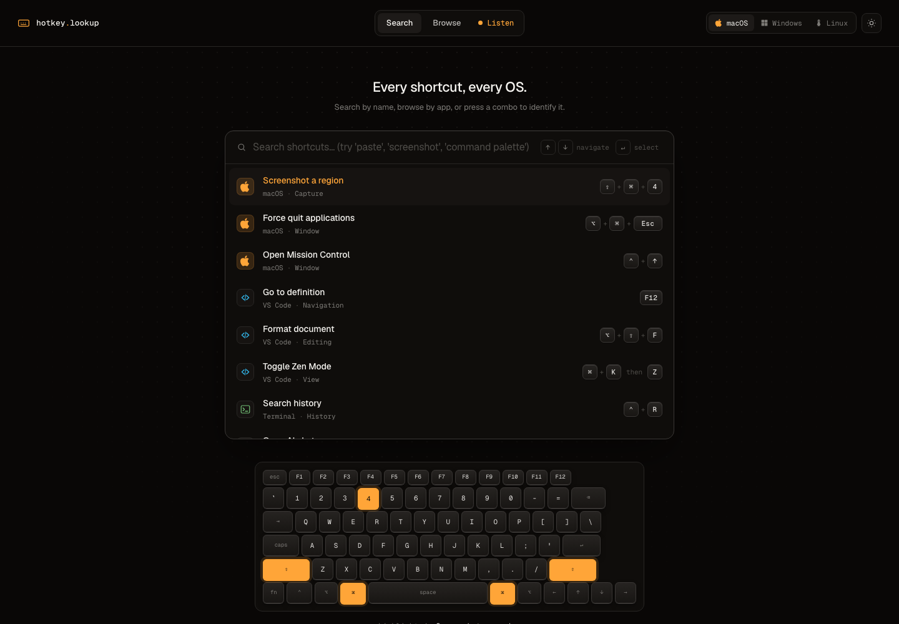

# Hotkey Lookup

Find keyboard shortcuts across macOS, Windows, Linux, and popular apps. Search by
what you want to do, or press a key combination to see what it does in each app.

**[Open hotkeylookup.com](https://hotkeylookup.com)**



- Search by action, browse by app, and compare shortcuts across operating systems.
- Identify a shortcut by pressing it in Listen mode.
- Open individual shortcut pages and printable OS cheatsheets.

The shortcut catalog lives in this repository. Search runs in the browser; the
optional product-update form sends the submitted email to Buttondown.

## Run locally

```sh
npm ci
npm run dev
```

Open [localhost:5173](http://localhost:5173). Run `npm run build` to type-check,
generate static HTML pages, and create the sitemap in `dist/`; use
`npm run preview` to inspect the build.

Built with React, TypeScript, Vite React SSG, Tailwind CSS, and Fuse.js. GitHub
Actions deploys the static build to GitHub Pages on pushes to `main`.

## Contribute

Shortcuts are stored in `src/data/shortcuts/`, with one file per app. See
[CONTRIBUTING.md](CONTRIBUTING.md) for adding or correcting entries.

[MIT license](LICENSE).
